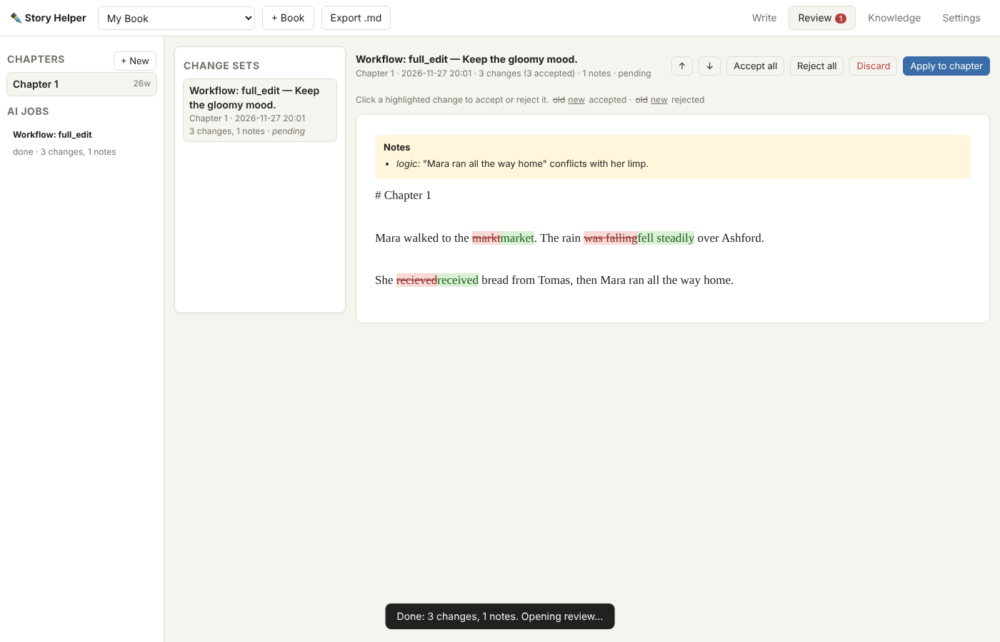
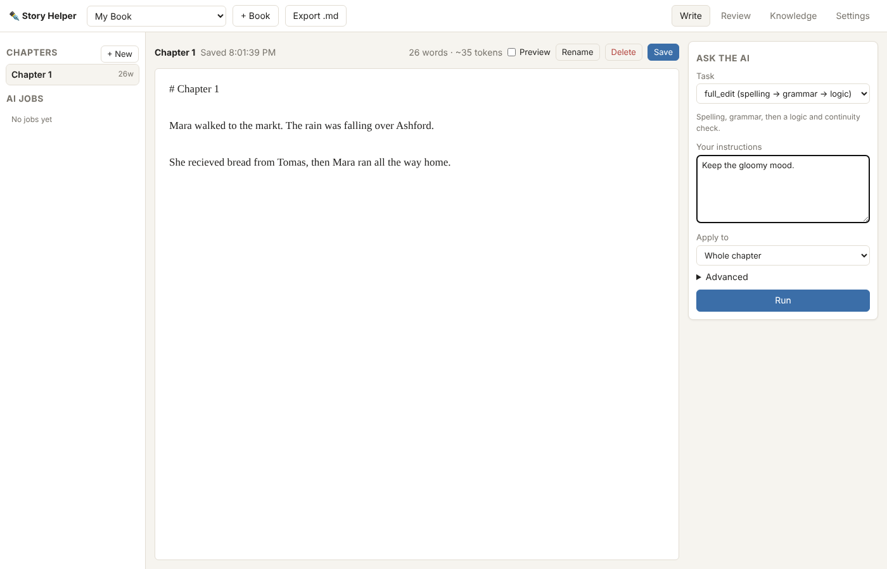
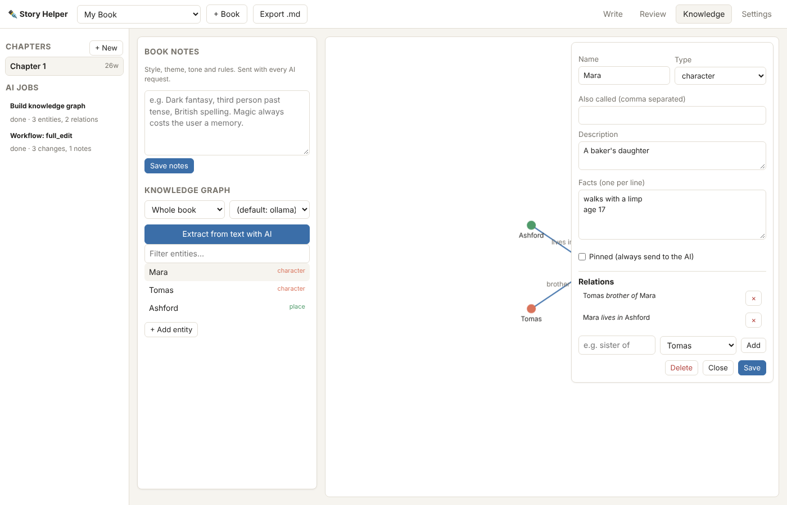

# Story Writing AI Helper

A web app for writing and editing books with AI. Write your manuscript in
Markdown, then ask a local model (Ollama) or an online one (Claude, Gemini) to
proofread it, check it for logic errors, or follow your own instructions such
as *"add more detail to this chapter but keep the facts and theme consistent"*.
Every change the AI suggests is highlighted so you can accept or reject it one
by one.



## Features

- **Write in the app.** A Markdown editor with autosave, live preview, word
  and token counts. Every chapter is a plain `.md` file in `data/books/<book>/chapters/`,
  so you can copy it anywhere. *Export .md* downloads the whole book as one file.
- **Rolling context window.** Long chapters are split into chunks on paragraph
  boundaries (sentence boundaries for very long paragraphs). Each request sends
  one chunk to edit plus some read-only text from before and after it, so the
  AI knows what surrounds the passage. Chunk size and overlap are set in
  `config/settings.yaml` and can be overridden for each run.
- **Task presets and your own instructions.** Spelling, grammar, logic and
  continuity check (notes only), expand with detail, or a free-form *custom* task.
  You can add instructions to any task, and run it on a whole chapter or just
  the text you selected.
- **Review with highlighted changes.** Word-level diffs: removed text in red,
  added text in green. Click any change to reject or accept it, or use Accept
  all / Reject all, then *Apply to chapter*. A backup of the chapter is saved
  in `history/` every time changes are applied.
- **Knowledge graph / mind map (optional).** Let the AI extract characters,
  places, objects, events and facts from the book, then edit them by hand. When
  the AI edits a passage, only the entities mentioned near that passage (plus
  any you *pin*) are sent along as a compact summary, so vital facts are kept
  with few tokens. *Book notes* (style, tone, theme, world rules) are sent with
  every request.
- **Configurable agents and workflows.** Agents (prompt, provider, model,
  temperature, edit or notes mode) and workflows (chains of agents) are YAML
  files you can edit in the app's *Settings* tab or in `config/`.
- **Pluggable providers.** Ollama, Claude (Anthropic API), Gemini, and an
  `echo` test provider. Each agent or run can use a different one.

| Write | Knowledge graph |
| --- | --- |
|  |  |

## Quick start with Docker

You need [Docker](https://docs.docker.com/get-docker/) with Docker Compose.

```bash
git clone https://github.com/spiderkitty72/Story-writing-AI-Helper.git
cd Story-writing-AI-Helper
cp .env.example .env          # add API keys here if you want Claude or Gemini
docker compose up -d --build
```

Then download a model into the bundled Ollama (once):

```bash
docker compose exec ollama ollama pull llama3.1:8b
```

Open <http://localhost:8000>. A book called *My Book* is created for you.

### Using an Ollama that is already on your computer

Set `OLLAMA_URL=http://host.docker.internal:11434` in `.env`, then start only
the app: `docker compose up -d --build app --no-deps`.

### Using Claude or Gemini

Put `ANTHROPIC_API_KEY` and/or `GEMINI_API_KEY` in `.env` and restart
(`docker compose up -d`). Choose the provider under **Advanced** when running a
task, or set `provider:` on an agent in `config/agents.yaml`, or change
`default_provider` in `config/settings.yaml`. The *Settings* tab shows whether
each provider is reachable.

## Running without Docker

Python 3.11 or newer:

```bash
python -m venv .venv && source .venv/bin/activate   # Windows: .venv\Scripts\activate
pip install -r requirements.txt
uvicorn app.main:app --reload
```

Books are stored in `./data` (change with `DATA_DIR`), configuration is read
from `./config` (change with `CONFIG_DIR`).

## How to use it

1. **Write.** Pick a chapter on the left or add one. Save with the button or
   Ctrl/Cmd+S (it also autosaves). Drag chapters to reorder them.
2. **Ask the AI.** In the panel on the right choose a workflow or single agent,
   type any extra instructions, and pick *Whole chapter* or *Selected text only*.
   Progress is shown under *AI jobs*.
3. **Review.** When the job finishes the *Review* tab opens. Notes from
   report agents (like the logic check) appear in yellow above the passage they
   refer to. Click changes to toggle them, use ↑ ↓ to jump between them, then
   *Apply to chapter*. If you edited the chapter in the meantime the app
   refuses to apply changes it can no longer place safely.
4. **Knowledge (optional).** On the *Knowledge* tab, write *Book notes*, click
   *Extract from text with AI* for the whole book or one chapter, and correct or
   pin entities. Click a node in the mind map to edit it; drag nodes to arrange.

## Configuration

All configuration lives in `config/` (mounted into the container, so edits
survive rebuilds). `${VAR}` and `${VAR:-default}` read environment variables.

### `settings.yaml`

```yaml
default_provider: ollama
providers:
  ollama: { type: ollama, base_url: "${OLLAMA_URL:-http://localhost:11434}", model: llama3.1:8b, num_ctx: 8192 }
  claude: { type: anthropic, api_key: "${ANTHROPIC_API_KEY:-}", model: claude-sonnet-5-5 }
  gemini: { type: gemini, api_key: "${GEMINI_API_KEY:-}", model: gemini-2.5-flash }
chunking:
  chunk_tokens: 1200     # text edited per request
  overlap_tokens: 300    # read-only context before each chunk (half as much after)
  knowledge_tokens: 600  # budget for the knowledge-graph summary
```

You can define several providers of the same type, for example a fast
`ollama-small` and a slower `ollama-big` with different models.

**Picking sizes:** with a local model, keep `chunk_tokens + overlap_tokens * 1.5
+ knowledge_tokens`, plus about the same as `chunk_tokens` again for the answer,
below the model's `num_ctx`. For *expand* tasks the answer is longer, so use
smaller chunks. Claude and Gemini have large context windows, so you can raise
`chunk_tokens` to 3000 or more.

### `agents.yaml`

```yaml
agents:
  dialogue:
    description: Make dialogue sound more natural.
    mode: edit            # edit = suggests changes; report = notes only
    provider: claude      # optional, otherwise default_provider
    model: claude-opus-5-5  # optional
    temperature: 0.6
    system: You are a dialogue coach for novelists.
    task: |
      Improve the dialogue so it sounds natural and fits each character.
      Do not change narration or plot. {instructions}
```

`{instructions}` is replaced with whatever you type in the app.

### `workflows.yaml`

```yaml
workflows:
  polish_dialogue:
    description: Dialogue pass, then proofread.
    steps:
      - agent: dialogue
      - agent: grammar
        instructions: Only fix errors.   # appended to your instructions for this step
        provider: ollama                 # optional per-step override
```

Each chunk passes through the steps in order; the output of an edit step is
the input of the next. All edits end up in one review.

### Adding a new provider

Subclass `Provider` in `app/providers/__init__.py`, implement `complete()`,
and add it to `PROVIDER_TYPES`. Then reference its `type` in `settings.yaml`.

## Where things are stored

```
data/books/<book>/
  book.yaml            title, book notes, chapter order
  chapters/*.md        your manuscript
  knowledge.json       knowledge graph
  reviews/*.json       AI change sets
  history/*.md         chapter backups made before applying AI changes
```

## Development

```bash
pip install -r requirements-dev.txt
pytest
```

The tests use a fake provider, so no model or API key is needed.

## Project layout

```
app/
  main.py         FastAPI routes and static UI
  engine.py       runs agents/workflows chunk by chunk, applies reviews, builds the knowledge graph
  chunking.py     rolling context window
  prompts.py      prompt building and answer clean-up
  diffing.py      word-level diffs with per-change accept/reject
  knowledge.py    knowledge graph merge and compact context
  providers/      Ollama, Anthropic, Gemini, echo
  storage.py      books, chapters, reviews on disk
  static/         the web UI (plain HTML, CSS and JavaScript)
config/           settings, agents, workflows
```
